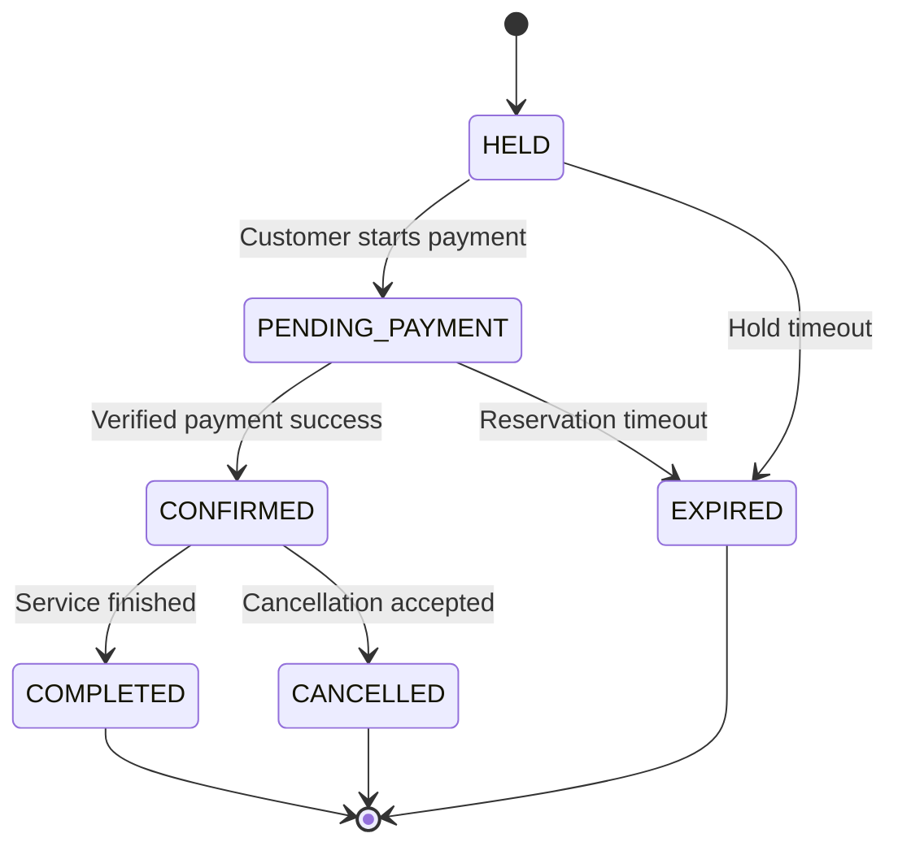
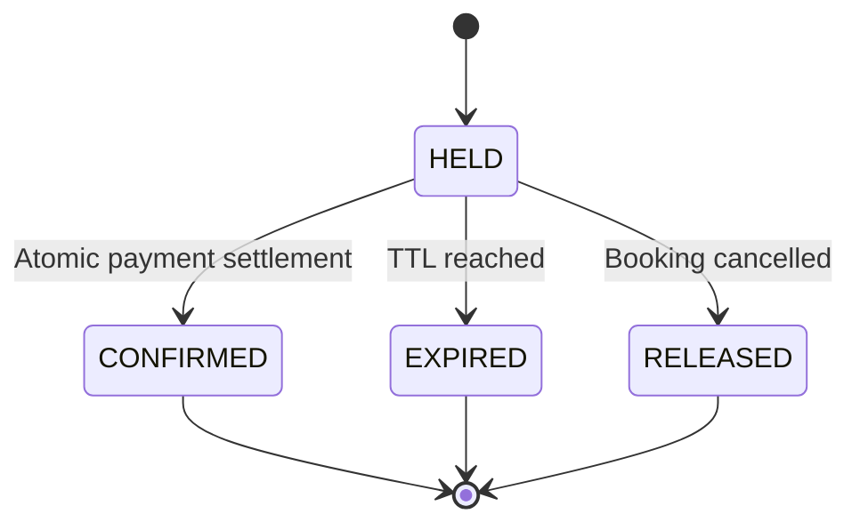
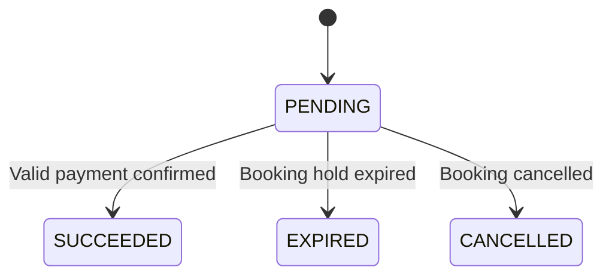
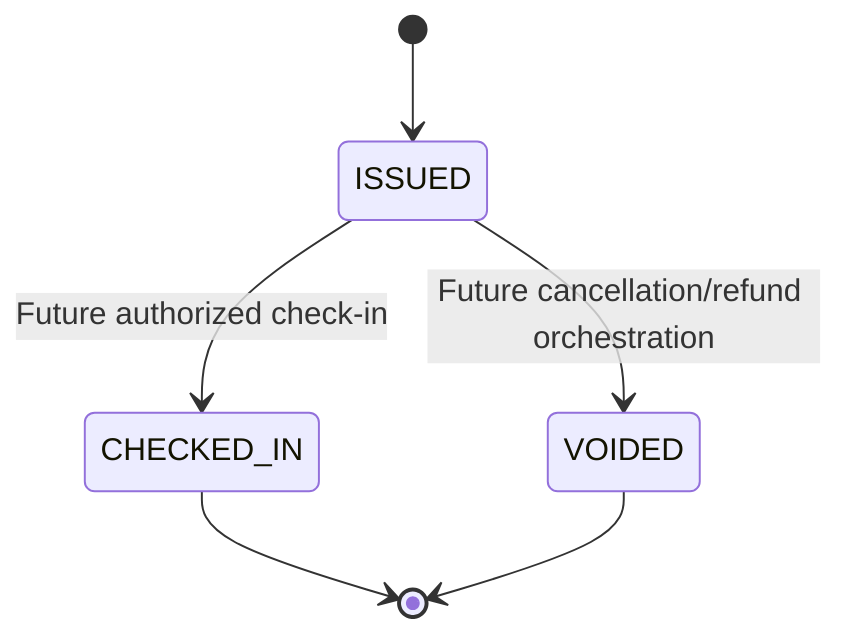
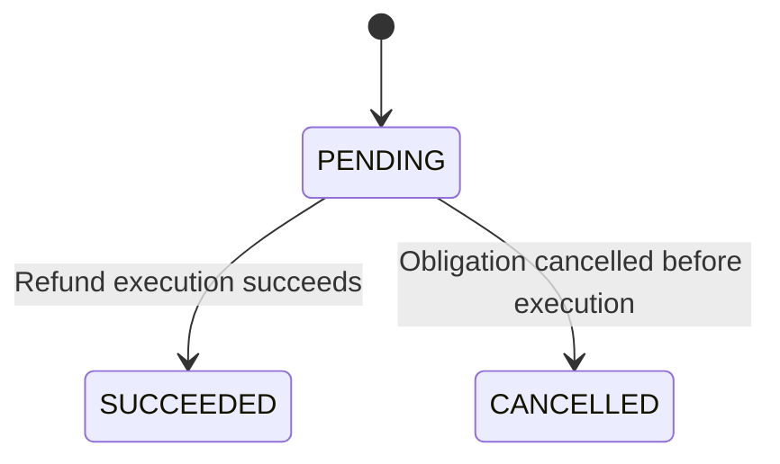

# GoBook — State Machine

## VoucherClaim lifecycle (current runtime)

```text
Booking Hold accepted -> VoucherClaim RESERVED
  ├─ Payment settled before hold expiry -> REDEEMED
  └─ Booking hold expired -> RELEASED
```

REDEEMED and RELEASED are terminal. Settlement locks Booking, Payment,
PaymentAttempt, Reservations ordered by id, then VoucherClaim, and atomically
confirms Booking/Reservations and redeems the claim. Duplicate payment events
see the already redeemed claim without consuming another use. Expiration locks
Booking first and releases a RESERVED claim in the same transaction as
Booking/Reservation expiry. Late payments cannot resurrect expired holds.
Paid cancellation leaves REDEEMED consumed, with no automatic recredit.

> Version: `v1.0.0-MVP`
> Mục tiêu: Xác định trạng thái và cách chuyển trạng thái của các domain quan trọng trong GoBook.

---

# 1. Vì sao cần State Machine?

Trong GoBook, một đối tượng không chỉ có trạng thái:

```text
PENDING
SUCCESS
FAILED
```

Mỗi domain có lifecycle riêng.

Ví dụ:

```text
Booking Status
Payment Status
Reservation Status
Ticket Status
Refund Status
```

Phải tách riêng để tránh logic bị lẫn.

---

# 2. Booking State Machine

## States

```text
HELD
PENDING_PAYMENT
CONFIRMED
COMPLETED
CANCELLED
EXPIRED
```

## Flow chính

```text
HELD
  ↓
PENDING_PAYMENT
  ↓
CONFIRMED
  ↓
COMPLETED
```

Các nhánh khác:

```text
HELD
  ↓
EXPIRED
```

```text
PENDING_PAYMENT
  ↓
EXPIRED
```

```text
CONFIRMED
  ↓
CANCELLED
```

---

## Mermaid



---

# 3. Booking Transition Rules

## HELD → PENDING_PAYMENT

Khi:

```text
Customer bắt đầu thanh toán.
```

Điều kiện:

```text
Reservation HELD
expires_at > now
```

---

## HELD → EXPIRED

Khi:

```text
Reservation hết thời gian giữ chỗ.
```

---

## PENDING_PAYMENT → CONFIRMED

Chỉ khi:

```text
SePay webhook hợp lệ
+
signature đúng
+
amount đúng
+
payment chưa được xử lý
```

Không được confirm booking từ:

```text
Return URL
```

---

## PENDING_PAYMENT → EXPIRED

Khi:

```text
Reservation hết hạn trước khi thanh toán được xác nhận.
```

---

## CONFIRMED → COMPLETED

Khi:

```text
Slot đã kết thúc.
```

Có thể do scheduled job thực hiện.

---

## CONFIRMED → CANCELLED

Khi:

```text
Customer hủy hợp lệ
```

hoặc:

```text
Vendor/Admin hủy theo business rule.
```

---

# 4. Reservation State Machine

## States

```text
HELD
CONFIRMED
EXPIRED
RELEASED
```

Flow:

```text
HELD
 ├──→ CONFIRMED
 ├──→ EXPIRED
 └──→ RELEASED
```

---

## Mermaid



---

# 5. Reservation Rules

## HELD → CONFIRMED

Khi:

```text
Booking được CONFIRMED.
```

Nghĩa là chỗ giữ tạm đã trở thành booking thật.

---

## HELD → EXPIRED

Khi:

```text
expires_at <= now
```

Capacity được trả lại.

---

## HELD → RELEASED

Khi:

```text
Booking bị hủy trước khi reservation được consume.
```

---

# 6. Payment State Machine

## States

```text
PENDING
SUCCEEDED
EXPIRED
CANCELLED
```

Allowed transitions:

```text
PENDING
├── SUCCEEDED
├── EXPIRED
└── CANCELLED
```

Terminal states:

```text
SUCCEEDED
EXPIRED
CANCELLED
```

`Payment` không có `FAILED`. Provider attempt có thể thất bại trong khi
aggregate vẫn `PENDING` để Customer retry trước khi Booking hold hết hạn.

Disallowed examples:

```text
SUCCEEDED -> PENDING
EXPIRED -> SUCCEEDED
CANCELLED -> SUCCEEDED
```

Generic PATCH không được đặt status tùy ý. SePay Gateway IPN hợp lệ ghi
`PaymentAttempt.succeededAt` và `Payment.succeededAt` cùng một database
transaction, sử dụng database time.

---

# 7. Payment Mermaid



---

# 8. Payment Concurrency Contract

Payment success và Booking expiration có thể chạy đồng thời. Cả hai flow lock
Booking trước. Atomic settlement tiếp tục lock theo thứ tự
`Booking -> Payment -> PaymentAttempt -> Reservations (ORDER BY id) -> VoucherClaim`, lấy
fresh database `clock_timestamp()` sau khi lock, rồi re-read toàn aggregate trước khi mutate. Expiration dùng
`FOR UPDATE SKIP LOCKED`, vì vậy chỉ một flow có thể thắng trên cùng Booking.

Nếu settlement thắng khi hold còn hạn, Attempt, Payment, Booking và toàn bộ
Reservations được cập nhật trong một transaction. Nếu expiration thắng,
Booking/Reservations ở trạng thái `EXPIRED`; payment đến muộn được ghi nhận
nhưng không resurrect capacity. Browser callback không tham gia state machine;
UX luôn đọc trạng thái authoritative từ backend.

---

# 9. PaymentAttempt State Machine

Một Payment có thể có nhiều attempt.

States:

```text
PENDING
SUCCEEDED
FAILED
CANCELLED
EXPIRED
```

Allowed transitions:

```text
PENDING
├── SUCCEEDED
├── FAILED
├── EXPIRED
└── CANCELLED
```

Tất cả outcome đều terminal. Retry tạo một `PaymentAttempt` mới; không chuyển
`FAILED -> PENDING`.

Ví dụ retry:

```text
Payment

Attempt 1 → FAILED
Attempt 2 → FAILED
Attempt 3 → SUCCEEDED
```

Payment cuối cùng:

```text
SUCCEEDED
```

Nếu Attempt #1 thất bại và Attempt #2 vẫn pending thì Payment aggregate vẫn
`PENDING`.

---

# 10. Ticket State Machine

## States

```text
ISSUED
CHECKED_IN
VOIDED
```

Flow:

```text
ISSUED
 ├──→ CHECKED_IN
 └──→ VOIDED
```

---

## Mermaid



---

# 11. Ticket Rules

## ISSUED → CHECKED_IN

Điều kiện:

```text
Booking CONFIRMED
Ticket belongs to Vendor
Ticket ISSUED
```

---

## ISSUED → VOIDED

Khi:

```text
Booking cancellation/refund flow invalidates the credential.
```

---

## CHECKED_IN

Không được:

```text
CHECKED_IN → ISSUED
```

trong flow thông thường.

Nếu scan lại:

```text
ALREADY_CHECKED_IN
```

---

# 12. Refund State Machine

States:

```text
PENDING
SUCCEEDED
CANCELLED
```

Flow:

```text
PENDING
   ├──→ SUCCEEDED
   └──→ CANCELLED
```

`SUCCEEDED` and `CANCELLED` are terminal. Repeating the same terminal operation
is idempotent and does not rewrite `succeededAt` or `cancelledAt`. The forbidden
transitions are `SUCCEEDED → PENDING/CANCELLED` and
`CANCELLED → PENDING/SUCCEEDED`.

---

## Mermaid



There is deliberately no aggregate `FAILED` state. A future provider executor
may record several failed `RefundAttempt` rows while the Refund obligation stays
`PENDING`, then transition the aggregate to `SUCCEEDED` after a later successful
attempt.

---

# 13. Refund Reservation and Payment State

Both `PENDING` and `SUCCEEDED` reserve the Payment balance:

```text
SUM(PENDING + SUCCEEDED refunds) <= Payment.amount
```

`CANCELLED` releases the reservation. Only `SUCCEEDED` contributes to the
derived `PaymentRefundState`:

```text
NONE | PARTIAL | FULL
```

`Payment.status` remains `SUCCEEDED`; it describes the original incoming
payment, not outgoing refund settlement.

The future orchestration boundary is:

```text
Customer cancellation request
  -> load Booking and immutable cancellation policy snapshot
  -> CancellationPolicyEngine item-level entitlement
  -> atomic Booking cancellation / Reservation handling / Ticket VOID
  -> RefundService.createRefundObligation in the same transaction
  -> Refund PENDING
  -> future provider executor
```

The Refund domain itself does not change Booking, Reservation, Ticket, or Slot
state and does not call SePay.

---

## Vendor Profile Lifecycle

Vendor profile được tạo ở trạng thái:

```text
DRAFT
```

Trong Vendor Profile CRUD, status là read-only và không có transition. Các
transition `DRAFT → PENDING → APPROVED/REJECTED` thuộc Vendor Application flow.

---

# 14. Vendor Application State Machine

States:

```text
PENDING
APPROVED
REJECTED
```

Flow:

```text
PENDING
 ├──→ APPROVED
 └──→ REJECTED
```

Application không có trạng thái `DRAFT`. Submit từ Vendor `DRAFT` hoặc
`REJECTED` tạo application mới `PENDING` và đồng bộ Vendor thành `PENDING`.

- `PENDING → APPROVED`: Admin review, Vendor thành `APPROVED`, owner nhận thêm
  role `VENDOR` nhưng vẫn giữ `CUSTOMER`.
- `PENDING → REJECTED`: Admin bắt buộc nhập lý do, Vendor thành `REJECTED`,
  không cấp role.
- Application terminal không được chuyển lại hoặc review lần hai.
- Review dùng transaction và conditional update nên chỉ một concurrent Admin
  transition có thể thành công.
- Mỗi transition terminal ghi `VendorApplicationHistory` và generic `AuditLog`
  trong cùng transaction; nếu ghi audit thất bại thì toàn bộ review rollback.

Nếu rejected:

User có thể sửa Vendor và tạo application `PENDING` mới. Application và history
cũ được giữ nguyên.

---

# 15. Service State Machine

States:

```text
DRAFT
PUBLISHED
HIDDEN
ARCHIVED
```

Allowed transitions:

```text
DRAFT
├── PUBLISHED
│      ↓
│    HIDDEN
│      ├── PUBLISHED
│      └── ARCHIVED
└── ARCHIVED
```

`PUBLISHED -> ARCHIVED` trực tiếp không hợp lệ; Vendor phải hide trước. `ARCHIVED`
là terminal state. Generic update không được thay đổi status; mỗi transition dùng
endpoint riêng và transition sai trả `409 Conflict`. Lần publish đầu tiên đặt
`published_at`; re-publish giữ nguyên timestamp này.

---

# 16. Slot State Machine

States:

```text
OPEN
CLOSED
CANCELLED
```

Allowed transitions:

```text
OPEN
├── CLOSED
│     ├── OPEN
│     └── CANCELLED
└── CANCELLED
```

`CANCELLED` là terminal state. Chỉ Slot chưa bắt đầu mới được `CLOSED -> OPEN`.
Generic PATCH không thay đổi status; invalid transition trả `409 Conflict`.

---

# 17. State Machine liên kết với nhau

Đây là phần quan trọng nhất.

```text
Reservation HELD
        ↓

Booking HELD
        ↓

Booking PENDING_PAYMENT
        ↓

Payment SUCCEEDED
        ↓

Booking CONFIRMED
        ↓

Reservation CONFIRMED
        ↓

Ticket ISSUED
```

---

# 18. Payment Success Transaction

Khi callback thanh toán hợp lệ:

```text
BEGIN TRANSACTION

PaymentAttempt
PENDING → SUCCEEDED

Payment
PENDING → SUCCEEDED

Booking
PENDING_PAYMENT → CONFIRMED

Reservation
ALL HELD → CONFIRMED

COMMIT
```

Các state và `confirmedAt` phải thay đổi cùng nhau. Mỗi BookingItem của hold
hiện tại phải có đúng một Reservation. Settlement kiểm tra expected row count;
thiếu hoặc mixed Reservation làm toàn transaction rollback/reconciliation.
Không tạo Ticket hoặc gửi notification trong transaction này.

Late-payment path:

```text
Payment received
        ↓
Booking already EXPIRED/CANCELLED
        ↓
NO automatic confirmation or resurrection
        ↓
manual reconciliation/refund required
```

Nếu hold vừa hết hạn nhưng expiration worker chưa finalize, settlement ghi nhận
Payment và atomically chuyển Booking/HELD Reservations sang `EXPIRED`.

---

# 19. Expiration Flow

Nếu hold hết hạn:

```text
Reservation
HELD → EXPIRED

Booking
PENDING_PAYMENT → EXPIRED
```

Không tạo Ticket.

---

# 20. Cancellation Flow

Khi hủy booking:

```text
Booking
CONFIRMED → CANCELLED

Ticket
ISSUED → VOIDED

Reservation
CONFIRMED → RELEASED

BookingCancellation
→ immutable audit record

Refund
→ PENDING when refundAmount > 0
```

Sau đó refund được xử lý async.

---

# 21. Trạng thái không được phép

Không cho:

```text
EXPIRED → CONFIRMED
```

Không cho:

```text
CANCELLED → CONFIRMED
```

Không cho:

```text
CHECKED_IN → ISSUED
```

Không cho:

```text
FAILED PaymentAttempt → PENDING / SUCCEEDED
```

Retry phải tạo attempt mới; attempt terminal không được tái sử dụng.

Không cho:

```text
COMPLETED → CANCELLED
```

trong customer flow MVP.

---

# 22. Backend phải kiểm tra Transition

Không làm:

```typescript
booking.status = input.status;
```

từ frontend.

Frontend không được tự quyết định status.

Backend phải có logic kiểu:

```text
confirmBooking()
cancelBooking()
expireBooking()
completeBooking()
```

Thay vì:

```text
updateBookingStatus(status)
```

---

# 23. Cancellation Evaluation Foundation

Branch cancellation-policy chỉ tính entitlement, không thêm hoặc thực thi
transition mới. Flow tương lai dự kiến:

```text
Booking creation
      ↓
immutable cancellation policy snapshot
      ↓
Booking CONFIRMED
      ↓
customer requests cancellation
      ↓
load Booking snapshot and BookingItem snapshots
      ↓
calculate every BookingItem refund independently
      ↓
aggregate Booking refund
      ↓
future atomic Booking cancellation
      ↓
future Ticket VOID and refund obligation/execution
```

Một Booking có thể chứa nhiều Slot start time. Không dùng earliest/latest/first
Slot để áp dụng một tỷ lệ cho toàn Booking. Whole-Booking cancellation chỉ có
thể tiếp tục khi mọi item đều cancellable. Nếu một số item đã non-cancellable
nhưng item khác còn cancellable, evaluation trả
`PARTIAL_CANCELLATION_REQUIRED`; partial item cancellation là future work.

Không có `CONFIRMED -> CANCELLED` mutation, Reservation/Ticket/Payment mutation,
hoặc refund execution trong task này.

---

# 24. State và HTTP Error

Nếu transition không hợp lệ:

```text
409 CONFLICT
```

Ví dụ:

```json
{
  "statusCode": 409,
  "code": "INVALID_BOOKING_STATE",
  "message": "Booking cannot be cancelled from current state"
}
```

---

# 25. State Logging

Các transition quan trọng nên log:

```text
Booking:
PENDING_PAYMENT → CONFIRMED

Payment:
PENDING → SUCCEEDED

Reservation:
HELD → CONFIRMED

Ticket:
ISSUED → CHECKED_IN
```

Log nên chứa:

```text
entityId
fromState
toState
requestId
actor
timestamp
```

---

# 26. Critical State Invariants

Luôn đúng:

```text
Booking CONFIRMED
→ Payment SUCCEEDED
```

```text
Ticket ISSUED
→ Booking CONFIRMED
```

```text
Ticket CHECKED_IN
→ Booking CONFIRMED or COMPLETED
```

```text
Reservation CONFIRMED
→ Booking CONFIRMED
```

```text
Booking EXPIRED
→ Reservation must not remain HELD
```

---

# 27. Core State Summary

```text
BOOKING

HELD
→ PENDING_PAYMENT
→ CONFIRMED
→ COMPLETED

HELD / PENDING_PAYMENT
→ EXPIRED

CONFIRMED
→ CANCELLED
```

```text
RESERVATION

HELD
→ CONFIRMED

HELD
→ EXPIRED

HELD
→ RELEASED
```

```text
PAYMENT

PENDING
→ SUCCEEDED / EXPIRED / CANCELLED

PaymentAttempt PENDING
→ SUCCEEDED / FAILED / EXPIRED / CANCELLED
```

```text
TICKET

ISSUED
→ CHECKED_IN

ISSUED
→ VOIDED
```

```text
REFUND

PENDING
→ PROCESSING
→ SUCCESS / FAILED
```

---

# 28. Nguyên tắc cuối cùng

Không xem:

```text
Booking
Payment
Reservation
Ticket
```

là cùng một state machine.

Chúng liên quan với nhau nhưng có lifecycle riêng.

Backend phải đảm bảo:

```text
VALID TRANSITION
+
DATABASE TRANSACTION
+
IDEMPOTENCY
```

để các trạng thái luôn đồng bộ và không phát sinh lỗi booking hoặc thanh toán.

Đây là State Machine chính thức cho **GoBook MVP v1.0.0**.

---

# 29. Booking Schema Foundation Update

Migration `booking_schema` implements the current Booking foundation with a
smaller state surface than the broader MVP design above. Atomic payment
settlement and hold expiration are implemented; refund, completion,
notification, and payout behavior remain future tasks. The Ticket foundation
is documented in section 30.

## Booking states currently represented in schema

```text
PENDING_PAYMENT
CONFIRMED
EXPIRED
CANCELLED
```

Allowed transitions:

```text
PENDING_PAYMENT
├── CONFIRMED
├── EXPIRED
└── CANCELLED

CONFIRMED
└── CANCELLED
```

Terminal for this foundation:

```text
EXPIRED
CANCELLED
```

Disallowed:

```text
EXPIRED -> CONFIRMED
CANCELLED -> CONFIRMED
CONFIRMED -> PENDING_PAYMENT
```

Generic PATCH must not set `Booking.status` directly. Future code should expose
intentful operations such as confirm, expire, and cancel.

## Reservation states currently represented in schema

```text
HELD
CONFIRMED
EXPIRED
RELEASED
```

Allowed transitions:

```text
HELD
├── CONFIRMED
├── EXPIRED
└── RELEASED

CONFIRMED
└── RELEASED
```

Terminal:

```text
EXPIRED
RELEASED
```

Disallowed:

```text
EXPIRED -> CONFIRMED
RELEASED -> HELD
CONFIRMED -> HELD
```

`Reservation.CONFIRMED` still exists after payment because Reservation
represents capacity allocation, not only a temporary cache-style hold.

## Hold creation and expiration behavior

`POST /api/v1/bookings/hold` creates only the initial states:

```text
Booking.status = PENDING_PAYMENT
Reservation.status = HELD
```

The hold endpoint does not implement payment confirmation, release, or
cancellation transitions. Payment confirmation is triggered only by the
trusted provider flow. Expiration finalization is implemented by the background
worker:

```text
Booking:
PENDING_PAYMENT
  └── expiresAt <= database NOW()
      └── EXPIRED

Reservation:
HELD
  └── expiresAt <= database NOW()
      └── EXPIRED
```

The worker locks/re-checks Booking first, then mutates related Reservations in
the same transaction. Payment settlement uses the same Booking lock-first rule
and only confirms a Booking that is still:

```text
PENDING_PAYMENT
AND expiresAt > database NOW()
```

If the worker runs late, capacity is still released on time because active
capacity counts only `HELD` reservations where `expiresAt > database NOW()`.
Finalization changes stale rows from `HELD` to `EXPIRED`; it is not the source
of capacity correctness.

---

# 30. Ticket Domain Foundation Update

Migration `ticket_domain` defines the implemented Ticket lifecycle as:

```text
ISSUED
├── CHECKED_IN
└── VOIDED
```

`CHECKED_IN` and `VOIDED` are terminal for normal flows. Check-in is implemented;
void/cancellation orchestration remains future work.

Ticket issuance is a separate post-confirmation operation. It requires a
`CONFIRMED` Booking and defensively requires every related Reservation to be
`CONFIRMED` with a quantity matching its BookingItem. It does not run inside the
payment settlement transaction and does not mutate Payment, Reservation
quantity, or Slot capacity.

Cryptographic verification establishes that a credential is authentic and
resolves its Ticket, regardless of whether the current status is `ISSUED`,
`CHECKED_IN`, or `VOIDED`. `TicketCheckInService` separately authorizes the
approved owning Vendor, requires `ISSUED`, atomically transitions to
`CHECKED_IN`, sets `checkedInAt` from database time and `checkedInByUserId` from
the authenticated User, and prevents duplicate redemption.

---

# 31. Ticket Validation Update

`POST /api/v1/vendor/tickets/validate` observes the Ticket state machine but
does not perform a transition:

```text
ISSUED     -> remains ISSUED
CHECKED_IN -> remains CHECKED_IN
VOIDED     -> remains VOIDED
```

The endpoint distinguishes credential authenticity, entitlement validity, and
eligibility to check in at the current database time:

```text
ISSUED + CONFIRMED + active Slot  -> VALID
ISSUED + future Slot              -> SLOT_NOT_STARTED
CHECKED_IN                        -> ALREADY_CHECKED_IN
VOIDED                            -> TICKET_VOIDED
cancelled/expired Booking         -> BOOKING_CANCELLED / BOOKING_EXPIRED
cancelled/elapsed Slot            -> SLOT_CANCELLED / SLOT_EXPIRED
```

`Slot.CLOSED` represents closed booking availability, not cancellation of the
scheduled occurrence, so it remains eligible when all other rules and the time
window pass. Time comparisons use PostgreSQL `NOW()`.

Validation never writes `status`, `checkedInAt`, `voidedAt`, `tokenNonce`, or
`tokenVersion`, and never mutates Booking, Reservation, Payment, Slot, or
capacity. A result is only a snapshot. The implemented check-in transaction
repeats credential, ownership, state, and time validation before atomically
changing `ISSUED -> CHECKED_IN`.

---

# 32. Ticket Check-In Update

```text
ISSUED
  └── approved owning Vendor confirms check-in
      └── CHECKED_IN (terminal)
```

The transition runs in one PostgreSQL transaction. It locks the parent Booking
and then the Ticket row, uses transaction database time, reuses the validation
policy, and issues a conditional update that still requires `status = ISSUED`.
The Booking-first order serializes check-in against whole-Booking cancellation.
The same transaction stores:

```text
checkedInAt       = database NOW()
checkedInByUserId = auth.sub
```

Sequential retries and losing concurrent requests return
`409 ALREADY_CHECKED_IN`; neither may change the original audit values. There
is no `CHECKED_IN -> ISSUED` transition, re-entry, or undo path in the MVP.

---

# 33. Booking Cancellation Orchestration Update

Customer cancellation supports a whole confirmed Booking only:

```text
Booking      CONFIRMED -> CANCELLED
Reservation  CONFIRMED -> RELEASED
Ticket       ISSUED    -> VOIDED
Refund       create PENDING when refundAmount > 0
```

`CHECKED_IN` is terminal and blocks cancellation. Existing `VOIDED` Tickets are
left unchanged. A confirmed Booking with zero Ticket rows can still be
cancelled. `Slot.capacity` is unchanged because active capacity is derived from
Reservation status.

`POST /api/v1/bookings/:bookingId/cancellation/preview` evaluates the immutable
Booking policy and per-item financial/time snapshots using database time. It is
read-only and is not a guarantee. `POST /api/v1/bookings/:bookingId/cancel`
requires a stable `Idempotency-Key` and recalculates after acquiring locks.

The accepted transaction is all-or-nothing:

```text
lock Booking
lock Payment
lock Reservations in id order
lock Tickets in id order
read database NOW()
revalidate ownership, status, snapshots, payment, reservations, tickets
recalculate item-level policy
Booking -> CANCELLED
Reservations -> RELEASED
ISSUED Tickets -> VOIDED
create BookingCancellation audit
create optional Refund PENDING through RefundService
commit
```

`PARTIAL_CANCELLATION_REQUIRED` is rejected because item cancellation is not yet
supported. `CANCELLATION_NOT_ALLOWED`, `POLICY_SNAPSHOT_MISSING`,
`BOOKING_AMOUNT_MISMATCH`, `INCONSISTENT_PAYMENT_STATE`,
`INCONSISTENT_RESERVATION_STATE`, and `TICKET_ALREADY_USED` produce no state
change.

Concurrent cancellations serialize on Booking and return the one persisted
decision. Check-in uses the same Booking-first order, so the only coherent race
outcomes are `CONFIRMED + CHECKED_IN` or `CANCELLED + VOIDED`; `CANCELLED +
CHECKED_IN` cannot commit. Refund reservation remains protected by the Payment
row lock and `PENDING + SUCCEEDED <= Payment.amount` invariant.

`Refund PENDING` means GoBook recorded the customer's entitlement. Actual SePay
or bank transfer execution, provider attempts/reconciliation, and customer
notification occur after commit in a future phase.
